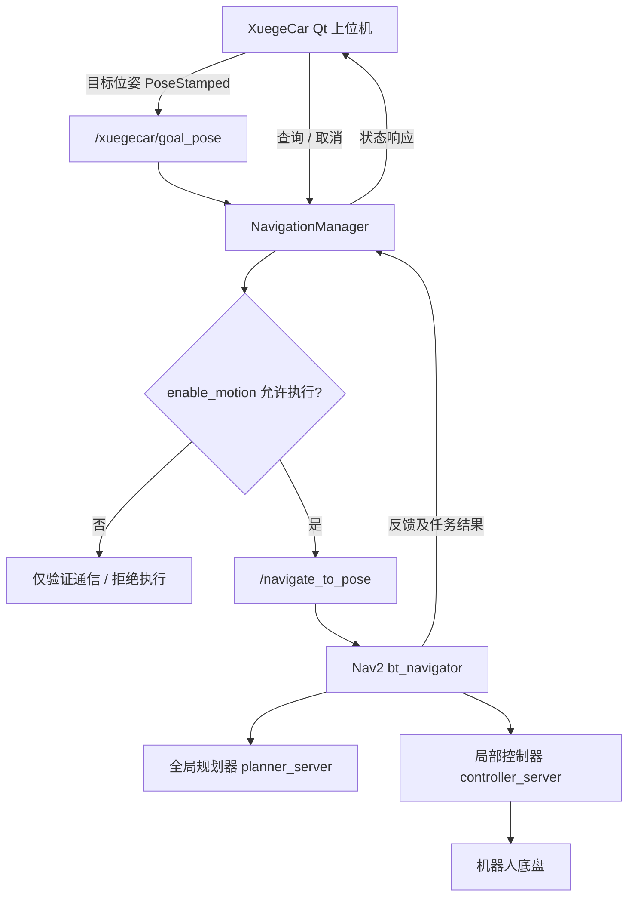

<div align="center">

# 🧭 XuegeCar NavigationManager

### ROS 2 智能小车导航任务管理模块

**XuegeCar 二次开发系列 · 第三期**


**Qt 目标位姿 · Nav2 Action · 任务状态 · 导航取消 · 运动权限**

</div>

---

## 📌 项目来源与声明

> 感谢 **出云科技** 提供的 ROS 2 智能小车硬件平台、基础开源工程和相关技术资料！
>
> 本仓库记录基于原有开源项目进行的导航任务管理功能二次开发与系统集成。ROS 2、AMCL、Nav2 及 NavFn 等第三方项目的算法不属于本仓库作者原创；其代码仍遵循各自许可证。
>
> 原始项目仓库链接：**待补充官方地址**。如本文件包含从原工程修改而来的代码，应按原项目许可证保留相应版权及许可声明。

## 📖 1. 项目介绍

`NavigationManager` 作为 XuegeCar Qt 上位机和 Nav2 之间的**应用层导航任务管理模块**，用于将地图上指定的目标位姿与 Nav2 自主导航执行流程连接起来，并提供任务状态与取消入口。

本模块**不是 A* 或 DWB 算法的重新实现**。全局路径规划和路径跟随由 Nav2 的对应组件负责，NavigationManager 着重管理上层交互、执行权限和任务生命周期。

### 设计目标

- 🎯 接收 Qt 发布的地图目标位姿；
- 🧭 对接 Nav2 的 `NavigateToPose` Action；
- 🔒 利用 `enable_motion` 参数将通信验证与实际运动分开；
- 📊 提供导航状态查询入口；
- ⏹️ 提供取消导航任务的入口。

> **说明：** 上述接口基于本项目此前调试使用的通信链路整理。仓库正式发布前，请与实际 `navigation_manager.py` 源码逐项核对具体函数、状态名和异常处理。

## ✨ 2. 核心功能

| 功能 | 对应接口/机制 | 用途 |
| :--- | :--- | :--- |
| 目标接收 | `/xuegecar/goal_pose` | 接收地图坐标系中的目标位姿 |
| 导航提交 | `/navigate_to_pose` | 将目标交给 Nav2 执行完整导航 |
| 运动权限 | `enable_motion` | 防止调试期间误提交运动任务 |
| 状态查询 | `/xuegecar/navigation_status` | 向 Qt 提供任务状态 |
| 导航取消 | `/xuegecar/cancel_navigation` | 请求结束当前导航任务 |

> `ComputePathToPose` 只计算路径；`NavigateToPose` 才会启动完整的导航执行流程。**规划成功不代表实车导航成功。**

## 🧩 3. 系统架构



该架构中，**AMCL + TF** 提供机器人在地图中的定位关系，**Costmap** 提供障碍物代价信息；它们是 Nav2 正常导航的重要依赖，而不是由 NavigationManager 自己实现。

## 🔗 4. ROS 2 接口

| 名称 | 预期类型 | 说明 |
| :--- | :--- | :--- |
| `/xuegecar/goal_pose` | `geometry_msgs/msg/PoseStamped` | Qt 选择的地图目标 |
| `/navigate_to_pose` | `nav2_msgs/action/NavigateToPose` | Nav2 导航 Action |
| `/xuegecar/navigation_status` | 以运行时检查为准 | 导航状态查询 |
| `/xuegecar/cancel_navigation` | 以运行时检查为准 | 导航取消请求 |
| `/xuegecar_navigation_manager` | ROS 2 Node | 任务管理节点 |

实际运行时确认接口类型：

```bash
ros2 topic type /xuegecar/goal_pose
ros2 action list -t | grep navigate_to_pose
ros2 service type /xuegecar/navigation_status
ros2 service type /xuegecar/cancel_navigation
```

## ⚙️ 5. 运行环境与依赖

- Ubuntu 22.04 / ROS 2 Humble；
- Python 3、`rclpy`；
- `geometry_msgs`、`nav2_msgs`、与实际源码匹配的服务消息包；
- 已正常运行的 Nav2、AMCL、TF 及底盘通信；
- 原 XuegeCar 项目中的 `xuegecar_system` 软件包和相应启动配置。

**注意：** 此仓库目前按“单模块源码展示”组织。仅下载 `navigation_manager.py` 并不等于具备完整的可编译、可运行工作空间。需将其按实际 `xuegecar_system` 包结构集成，并核对 `setup.py` 的运行入口与依赖。

## 🚀 6. 启动与非运动验证

先确认底盘安全停止、定位及 Nav2 生命周期正常。

### 6.1 加载环境并启动管理节点

```bash
source /opt/ros/humble/setup.bash
source ~/xuegeros_ws/install/setup.bash
ros2 run xuegecar_system navigation_manager
```

> 上述命令适用于已在工作空间正确安装该节点的情况。

### 6.2 确认 Nav2 核心节点已激活

```bash
ros2 lifecycle get /amcl
ros2 lifecycle get /planner_server
ros2 lifecycle get /controller_server
ros2 lifecycle get /bt_navigator
```

正常运行时应显示 `active [3]`；如果有节点未激活，请先排查，不要发送真实运动目标。

### 6.3 保持运动权限关闭

```bash
ros2 param get /xuegecar_navigation_manager enable_motion
```

非运动调试时应确认返回 `False`。如果不是，应在确认**没有正在执行的导航任务**后再调整；该参数**不是物理急停**，也不会自动取消已经执行的目标。

### 6.4 验证 Qt 目标位姿链路

```bash
ros2 topic echo /xuegecar/goal_pose --once
```

随后在 Qt 地图上指定目标并确认发布，查看终端是否收到 `frame_id: map` 和目标坐标、朝向。此步骤用于验证消息通信，不等于启动导航。

### 6.5 查询任务状态

先执行：

```bash
ros2 service type /xuegecar/navigation_status
```

**如果确认**返回 `std_srvs/srv/Trigger`，再执行：

```bash
ros2 service call /xuegecar/navigation_status std_srvs/srv/Trigger "{}"
```

### 6.6 正常取消任务

同样先确认 `/xuegecar/cancel_navigation` 的服务类型。若为 `std_srvs/srv/Trigger`：

```bash
ros2 service call /xuegecar/cancel_navigation std_srvs/srv/Trigger "{}"
```

> ⚠️ 软件取消不等于立即停车。真实机器人必须具备可靠的物理电机停止/断电方式；异常运动时应优先使用物理停止。

## 🧪 7. 验证情况与边界

| 检查项 | 当前记录 |
| :--- | :--- |
| Qt 目标位姿发布 | 已通过此前终端回显验证 |
| AMCL 与 Nav2 核心节点激活 | 已通过此前生命周期检查 |
| `ComputePathToPose` 路径计算 | 此前已完成一次成功的规划测试 |
| NavigationManager 全部状态与取消分支 | 待核对完整源码及日志 |
| `NavigateToPose` 实车抵达目标 | 待补充明确的实车结果 |
| 动态障碍物避让 | 尚不能仅凭插件配置认定验证成功 |

本仓库的功能完成度应以实际测试和日志为准，避免把“接口存在”“规划成功”写成“全流程可靠自主导航”。

## 💡 8. 二次开发价值

1. **统一上层接口：** 将 Qt 目标选择与 Nav2 Action 交互连接起来；
2. **调试权限门控：** 支持先检查消息，再决定是否放行运动任务；
3. **任务可观测性：** 为图形界面提供查询任务状态的入口；
4. **任务取消能力：** 将软件取消操作纳入 Qt 的统一工作流。

这是一项**机器人应用层系统集成**工作，而不是对 Nav2 内部 A* 算法或 DWB 算法的原创声明。

## 📂 9. 仓库结构

```text
xuegecar-navigation-manager/
├── navigation_manager.py  # 真实运行的完整源码（自行上传）
├── README.md              # 本说明文档
└── LICENSE                # 核实许可证后再添加
```

## 📚 10. 相关项目与系列文章

- **第一期：ModeManager** — [xuegecar-mode-manager](https://github.com/wy1977-wq/xuegecar-mode-manager)
- **第二期：MapManager** — `xuegecar-map-manager`（仓库链接待确认）
- **第三期：NavigationManager** — 当前仓库
- **CSDN 第三期文章** — 待发布后补充链接

参考接口文档：[Nav2 NavigateToPose (Humble)](https://api.nav2.org/actions/humble/navigatetopose.html)

## 📜 11. 许可证

本仓库中的原始项目代码、第三方组件与本人独立编写的部分，可能受到不同许可证约束。**正式添加 LICENSE 前，应先核实出云科技原仓库的许可证、来源和本文件的实际代码归属。**

---

<div align="center">

**⭐ 感谢出云科技以及 ROS 2 / Nav2 开源社区的贡献！**

*让地图上的一个目标点，成为可管理、可查询、可取消的导航任务。*

</div>
