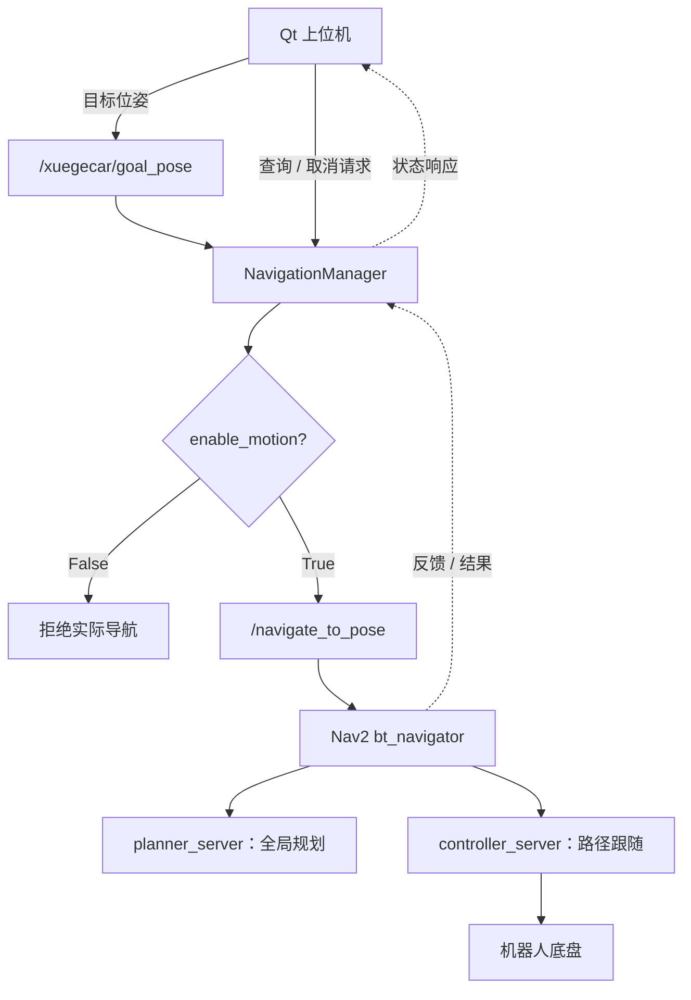

# 🧭 XuegeCar NavigationManager

### ROS 2 智能小车二次开发系列 · 第三期


**Qt 目标位姿 · Nav2 Action · 状态查询 · 导航取消 · 运动权限管理**

---

## 📌 项目来源与声明

> 感谢 **出云科技** 提供的 ROS 2 智能小车硬件平台、基础开源工程与技术资料。
>
> 本仓库记录基于原开源工程进行的导航任务管理功能二次开发与系统集成。ROS 2、AMCL、Nav2、NavFn 等第三方组件及算法不属于本仓库作者原创，使用和分发须遵守对应许可证。

## 📖 1. 项目介绍

`NavigationManager` 是 XuegeCar **Qt 上位机与 Nav2 之间的应用层导航任务管理模块**。它接收地图中指定的目标位姿，将请求交给 Nav2，并为上位机提供任务状态与取消入口。

**设计原则：Qt 负责用户交互，NavigationManager 管理任务，Nav2 负责规划和路径跟随。**

本模块**没有重新实现 A* 或 DWB 算法**。

### 主要目标

- 接收 Qt 发布的导航目标位姿。
- 对接 Nav2 的 `NavigateToPose` Action。
- 通过 `enable_motion` 区分通信调试与实际运动。
- 提供导航状态查询和任务取消入口。
- 降低 Qt 界面与底层 Nav2 接口之间的耦合。

> **源码说明：** 本文依据目前已验证的通信接口与测试记录整理。具体函数名、状态枚举、超时与异常处理，仍需与完整 `navigation_manager.py` 对照核实。

## ✨ 2. 核心功能

| 功能 | 接口 / 机制 | 作用 |
| :--- | :--- | :--- |
| 🎯 目标接收 | `/xuegecar/goal_pose` | 获取地图坐标系中的目标位姿 |
| 🧭 导航执行 | `/navigate_to_pose` | 提交 Nav2 导航任务 |
| 🔒 运动权限 | `enable_motion` | 控制是否允许提交运动任务 |
| 📊 状态查询 | `/xuegecar/navigation_status` | 向 Qt 返回任务状态 |
| ⏹️ 导航取消 | `/xuegecar/cancel_navigation` | 请求取消当前目标 |

**注意：** `ComputePathToPose` 用于规划路径；`NavigateToPose` 用于执行完整的导航任务。**规划成功 ≠ 实车导航成功。**

## 🧩 3. 系统架构



### 各模块职责

| 模块 | 主要职责 |
| :--- | :--- |
| Qt 上位机 | 选择目标、显示状态、发起取消 |
| NavigationManager | 处理目标、权限、任务状态和取消 |
| `bt_navigator` | 组织导航任务及行为树 |
| `planner_server` | 计算全局路径 |
| `controller_server` | 跟随路径并输出速度指令 |
| AMCL / TF | 提供地图与机器人之间的定位关系 |
| Costmap | 提供障碍物与通行代价信息 |

> 如果 StackEdit 未渲染 Mermaid 流程图，请以 GitHub 的 README 预览为准；图表渲染支持取决于编辑器版本。

## 🔗 4. ROS 2 接口

| 名称 | 消息类型 / 用途 |
| :--- | :--- |
| `/xuegecar/goal_pose` | `geometry_msgs/msg/PoseStamped` |
| `/navigate_to_pose` | `nav2_msgs/action/NavigateToPose` |
| `/xuegecar/navigation_status` | 状态查询服务；具体类型待运行时确认 |
| `/xuegecar/cancel_navigation` | 导航取消服务；具体类型待运行时确认 |
| `/xuegecar_navigation_manager` | ROS 2 管理节点名称 |

在 Ubuntu 中核对实际接口：

```bash
ros2 topic type /xuegecar/goal_pose
ros2 action list -t | grep navigate_to_pose
ros2 service type /xuegecar/navigation_status
ros2 service type /xuegecar/cancel_navigation
```

## ⚙️ 5. 环境与依赖

| 项目 | 环境 |
| :--- | :--- |
| 操作系统 | Ubuntu 22.04 |
| ROS 2 | Humble |
| 语言 | Python 3 / `rclpy` |
| 导航框架 | Nav2 |
| 定位 | AMCL / TF |
| 上位机 | Qt |
| 硬件平台 | XuegeCar |

依赖包括 `geometry_msgs`、`nav2_msgs`、实际源码使用的服务消息包，以及原工程中的 `xuegecar_system` 软件包和 Nav2 启动配置。

**本仓库是单模块源码展示，不是完整的独立 ROS 2 工作空间。** 单独下载 `navigation_manager.py` 不足以运行整套机器人系统。若需复现，应将文件按原 `xuegecar_system` 的实际包结构集成，并配置对应安装入口和依赖。

## 🚀 6. 启动与非运动验证

以下步骤用于**接口检查和非运动调试**，不作为直接启动实车自主运动的指令。

### 6.1 加载环境并启动节点

```bash
source /opt/ros/humble/setup.bash
source ~/xuegeros_ws/install/setup.bash
ros2 run xuegecar_system navigation_manager
```

> 该命令适用于节点已在 `xuegeros_ws` 中正确安装的情况。

### 6.2 检查 Nav2 生命周期

```bash
ros2 lifecycle get /amcl
ros2 lifecycle get /planner_server
ros2 lifecycle get /controller_server
ros2 lifecycle get /bt_navigator
```

上述节点应处于 `active [3]`。若未激活，应先处理启动问题。

### 6.3 检查运动权限

```bash
ros2 param get /xuegecar_navigation_manager enable_motion
```

非运动调试时确认其为 `False`。如果已经存在执行中的导航任务，应先通过正常取消流程确认任务结束及底盘停止。

> `enable_motion` 不是物理急停。将它设为 `False` 不会自动取消已在执行的任务。

### 6.4 检查 Qt 目标发布

在新终端中运行：

```bash
ros2 topic echo /xuegecar/goal_pose --once
```

随后在 Qt 地图中指定并确认目标。终端应收到 `PoseStamped`，并能看到 `frame_id: map`、位置坐标和朝向数据。

**这一步验证通信链路，不代表小车将开始移动。**

### 6.5 查询任务状态

先检查服务类型：

```bash
ros2 service type /xuegecar/navigation_status
```

**仅当返回** `std_srvs/srv/Trigger` 时，执行：

```bash
ros2 service call /xuegecar/navigation_status \
  std_srvs/srv/Trigger "{}"
```

### 6.6 正常取消导航

先检查服务类型：

```bash
ros2 service type /xuegecar/cancel_navigation
```

**仅当返回** `std_srvs/srv/Trigger` 时，执行：

```bash
ros2 service call /xuegecar/cancel_navigation \
  std_srvs/srv/Trigger "{}"
```

> ⚠️ 软件取消不保证立即停车。真实机器人必须配置可靠的物理停止或电机断电手段；遇到异常运动，应立即使用物理停止方式。

## 🧪 7. 已验证内容与待完成测试

| 检查项 | 当前记录 |
| :--- | :--- |
| Qt 目标位姿发布 | 已通过终端回显检查 |
| AMCL 与 Nav2 生命周期 | 已完成基础检查 |
| `ComputePathToPose` 路径规划 | 已有成功规划结果 |
| NavigationManager 各状态与取消分支 | 待完整源码及日志核对 |
| `NavigateToPose` 实车抵达目标 | 待补充明确实车记录 |
| 动态障碍物避让 | 尚需单独测试 |

**测试边界：** 已配置障碍物层不等于已验证动态避障能力；路径规划成功也不等于机器人已经完成目标导航。

## 💡 8. 二次开发价值

**统一任务接口。** 让 Qt 通过明确的 ROS 2 接口访问 Nav2，而无需在界面中堆叠导航管理逻辑。

**运动权限门控。** 将目标消息验证与真实导航执行分开，降低开发调试时误提交运动任务的风险。

**状态与取消入口。** 为 Qt 提供查看导航进度和请求取消任务的接口，增强实际操作的完整性。

这些改进属于**应用层程序设计与工程集成**，并非对 Nav2 原有算法的重新实现。

## 📂 9. 仓库结构

```text
xuegecar-navigation-manager/
├── navigation_manager.py
├── README.md
└── LICENSE             # 可选，核实授权后添加
```

若后续计划将此模块做成可独立安装的 ROS 2 软件包，需要补充真实包结构和相关构建文件。

## 📚 10. 系列文章

| 期数 | 模块 | 主要功能 |
| :--- | :--- | :--- |
| 第一期 | ModeManager | SLAM / Nav2 多模式运行管理 |
| 第二期 | MapManager | Gmapping 地图保存管理 |
| **第三期** | **NavigationManager** | **Qt 与 Nav2 导航任务交互** |

**系列名称：** ROS 2 智能小车二次开发实战

- 第一期仓库：`xuegecar-mode-manager`
- 第二期仓库：`xuegecar-map-manager`
- 本期仓库：`xuegecar-navigation-manager`
- CSDN 第三期文章：待发布

## 📜 11. 开源与版权

本项目用于 ROS 2 智能机器人技术学习、研究和二次开发交流。

感谢出云科技提供原始小车硬件和基础开源工程。原创代码、原项目派生代码及第三方依赖，应分别遵守适用的版权声明和开源许可证。仓库许可证将在完成代码来源核对后确定。

---

**⭐ 感谢出云科技与 ROS 2 / Nav2 开源社区！**

*让地图上的一个目标点，成为可提交、可查询、可取消的导航任务。*
